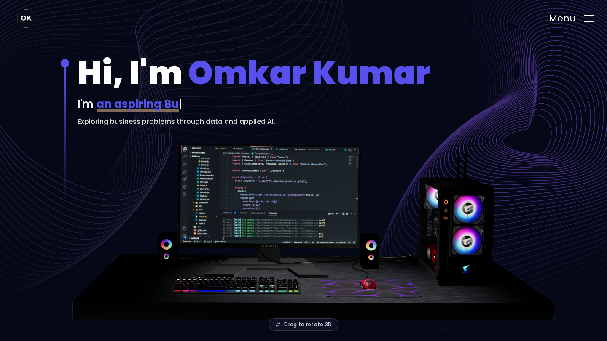

# Omkar Kumar | Business Analytics & Applied AI

B.E. Electronics Engineering (VLSI), Thapar Institute of Engineering & Technology, Class of 2027. Exploring Business Analyst and AI/ML Engineer opportunities through data analysis and applied AI projects.

[GitHub](https://github.com/omkark2404) · [LinkedIn / contact](https://www.linkedin.com/in/omkarkr/)



## Selected projects

| Project | Problem and implementation | Evidence |
|---|---|---|
| FinOps Copilot | Explore cloud billing, statistical forecasts and anomaly flags; optional AI explanations | [Source](https://github.com/omkark2404/finops-copilot) |
| Pathfinder | Explore delivery scenarios, route optimisation and risk scoring | [Source](https://github.com/omkark2404/Pathfinder--AI-Powered-Last-Mile-Delivery-Decision-Intelligence) |
| FraudLens-AI | Extract document fields with PaddleOCR and support review with heuristic checks | [Source](https://github.com/omkark2404/FraudLens-AI) |
| CodeFusion | Collaborative editing, Socket.IO synchronisation and WebRTC communication | [Source](https://github.com/omkark2404/CodeFusion) |
| Ecommerce Funnel Analytics | Analyse conversion and drop-off with MySQL and reproducible Python charts | [Source](https://github.com/omkark2404/Ecommerce_funnel-analytics) |

Project summaries describe repository functionality, not proof of sole authorship, real-world deployment or commercial impact. Synthetic and illustrative examples are labelled in the project details. CodeFusion's inherited attribution is retained; individual contributions require clarification.

## Portfolio contribution and attribution

This is a content adaptation of [Jayant Sunil Potdar's 3D Portfolio](https://github.com/Jayant-1/3D-Portfolio). The original React/Vite architecture, visual design, animation system and 3D assets are inherited. Adaptation work includes personalised identity, repository-backed project data and images, contact links, branding, and presentation/failure-handling fixes. This repository does not claim the original template engineering as Omkar's work.

The original MIT licence and model attribution notices remain intact. See [asset provenance](ASSET_SOURCES.md).

## Run locally

Use a maintained Node.js release compatible with the existing lockfile.

```bash
git clone https://github.com/omkark2404/Omkar-portfolio-.git
cd Omkar-portfolio-
npm ci
npm run dev
```

```bash
npm run build
npm run preview
```

The production output is `dist`. React, Vite, Tailwind, Three.js/React Three Fiber, Spline, GSAP and Framer Motion provide the inherited presentation stack. No dependency versions were upgraded during the content migration.

## Current availability

- Contact is available through LinkedIn. The email form is hidden until a verified recipient is configured.
- No final résumé PDF or verified credentials/testimonials are published. Empty panels and the unfinished public résumé have been removed.
- Project source links are available; unverified live-demo links are not presented.
- No hosted portfolio URL is configured. Publishing requires separate deployment work.
- Optional visuals depend on external runtime resources. React rendering errors in isolated scenes have a fallback; unrestricted-network and real-device validation remains outstanding.

## Verification and maintenance

`npm run build` checks production compilation. A pull-request/push workflow runs the locked install and build. Lint/typecheck are not currently configured. Historical migration checks used local files that are retained in the review ZIP, not shipped in this repository; those are not current CI commands.

[Current maintenance notes](PERSONALIZATION_REPORT.md) · [Deployment instructions](VERCEL_DEPLOYMENT.md)
